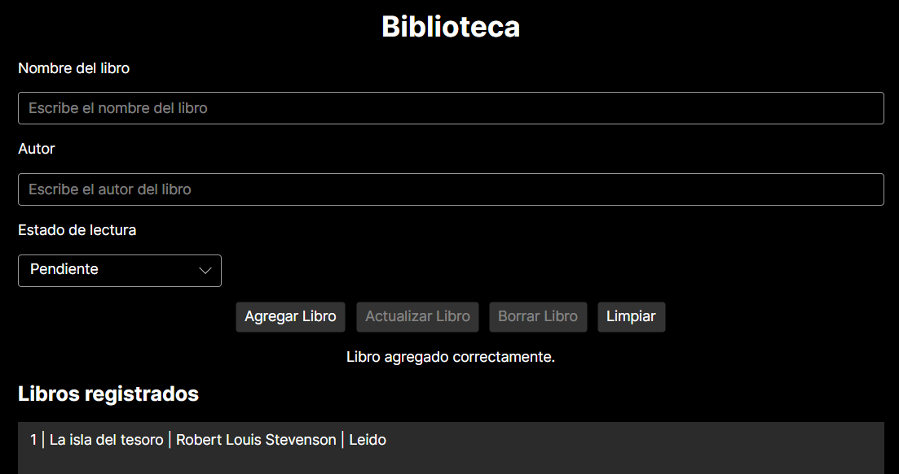
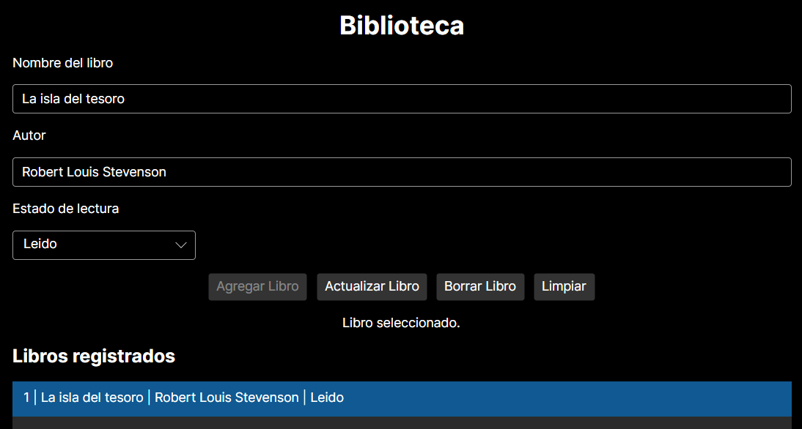
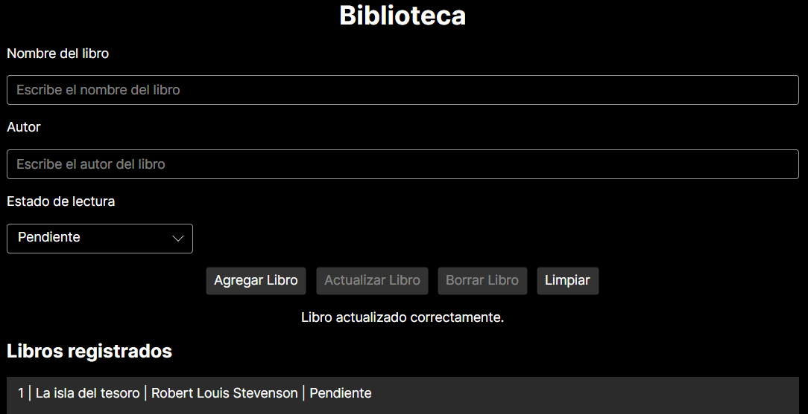
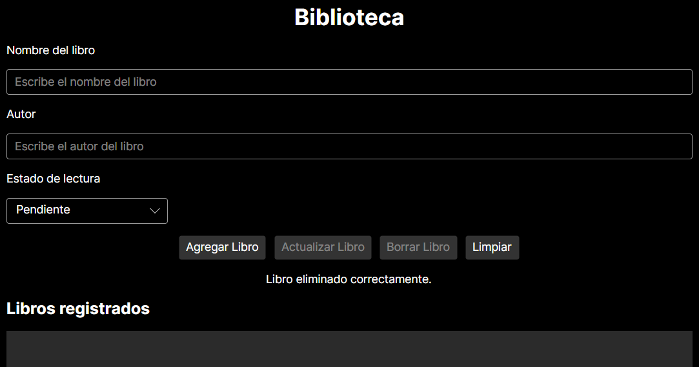
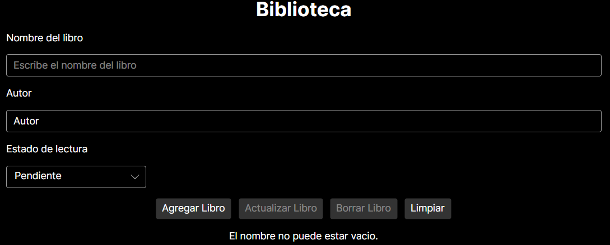
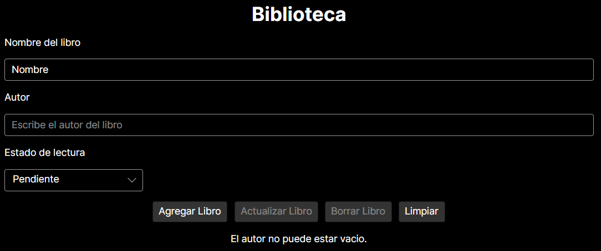
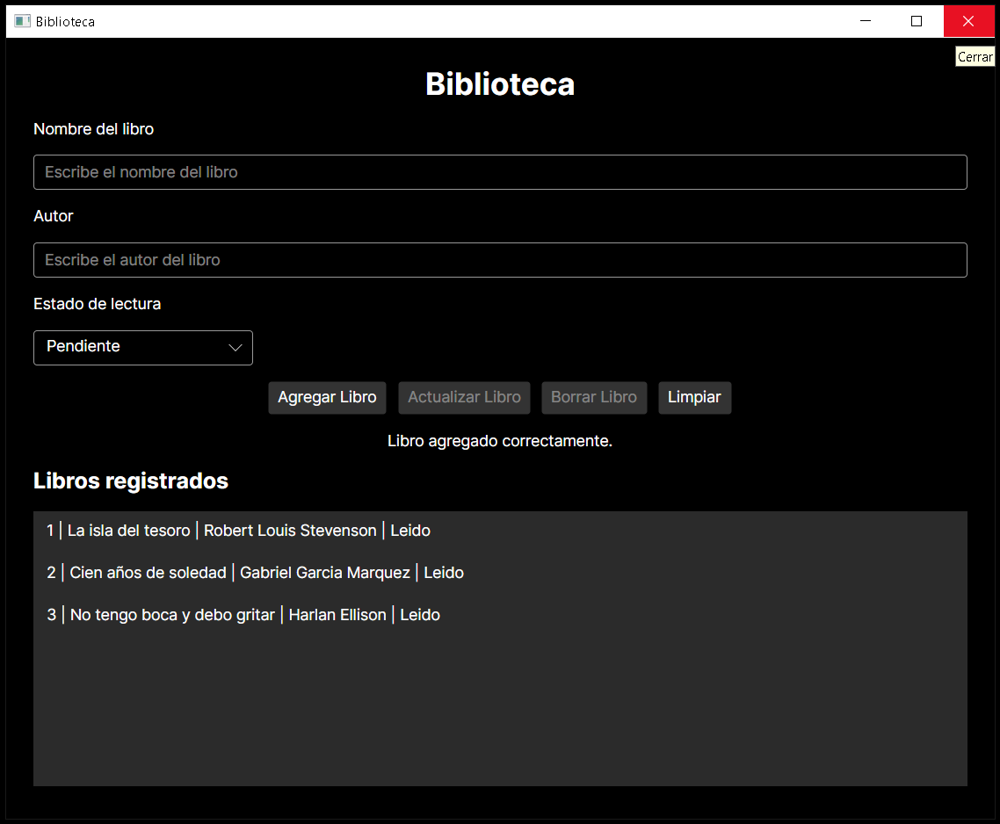
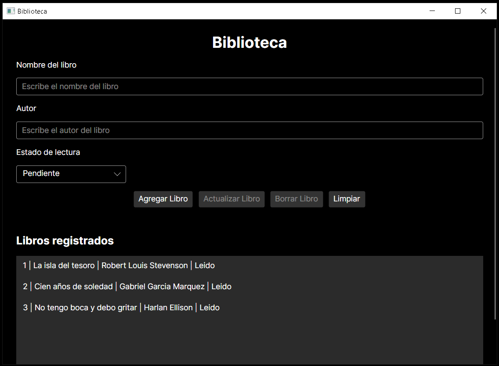

# Biblioteca Personal

**Estudiante:** Hilbert Sarmiento

## 1. Información general

**Descripción:** aplicación de escritorio para administrar una biblioteca personal. Permite registrar libros con su autor y su estado de lectura, y los almacena en una base de datos SQLite.

**Problema que resuelve:** llevar el control de los libros que se tienen, se están leyendo o están pendientes, sin perder la información al cerrar el programa.

**Objetivo principal:** aplicar POO, Avalonia UI y ADO.NET en una aplicación con CRUD completo y persistencia de datos.

## 2. Funcionalidades

- **Agregar:** guarda un libro con nombre, autor y estado (Pendiente, Leyendo, Leído).
- **Consultar:** la lista se carga automáticamente al abrir la aplicación y se actualiza tras cada operación.
- **Actualizar:** al seleccionar un libro de la lista, sus datos pasan al formulario y pueden modificarse.
- **Borrar:** elimina el registro seleccionado.
- **Limpiar:** vacía el formulario y quita la selección.
- **Validaciones:** el nombre y el autor no pueden estar vacíos. Los errores se muestran en pantalla sin cerrar el programa.
- Los botones Actualizar y Borrar solo se activan cuando hay un libro seleccionado, y Agregar solo cuando no lo hay.

## 3. Tecnologías utilizadas

| Tecnología | Versión |
|---|---|
| SDK de .NET | 8.0.424 (`net8.0`) |
| Lenguaje | C# |
| Interfaz gráfica | Avalonia UI 11.3.23 |
| Acceso a datos | ADO.NET con `Microsoft.Data.Sqlite` 8.0.26 |
| Base de datos | SQLite |

Paquetes del proyecto: `Avalonia`, `Avalonia.Desktop`, `Avalonia.Themes.Fluent`, `Avalonia.Fonts.Inter`, `Microsoft.Data.Sqlite` y `AvaloniaUI.DiagnosticsSupport`.

## 4. Estructura del proyecto

```
parcialFinal/
├── Data/
│   └── LibroADO.cs
├── Modelos/
│   └── Libro.cs
├── Servicios/
│   └── LibroServicio.cs
├── Validaciones/
│   └── Validaciones.cs
├── Views/
│   ├── MainWindow.axaml
│   └── MainWindow.axaml.cs
├── evidencias/
├── App.axaml
├── App.axaml.cs
├── app.manifest
├── Program.cs
├── .gitignore
└── parcialFinal.csproj
```

### Clases principales

| Clase | Responsabilidad |
|---|---|
| `MainWindow` | Interfaz gráfica. Recoge los datos del formulario, atiende los eventos de los botones y muestra mensajes y la lista. No contiene SQL. |
| `LibroServicio` | Capa intermedia. Recibe los datos de la ventana, crea los objetos `Libro` y llama a `LibroADO`. Inicializa la base de datos al crearse. |
| `LibroADO` | Acceso a datos. Contiene la conexión a SQLite y todas las sentencias SQL del CRUD. |
| `Libro` | Modelo. Representa un libro y valida sus datos. |
| `Validaciones` | Clase estática con las reglas de validación (nombre, autor, estado, ID). |
| `EstadoLectura` | Enumeración con los estados: Pendiente, Leyendo, Leido. |

**Flujo:** `MainWindow` → `LibroServicio` → `LibroADO` → SQLite.

### Dónde se aplica POO

- **Clases y objetos:** `Libro` representa cada elemento del sistema.
- **Propiedades y encapsulamiento:** las propiedades de `Libro` tienen `private set`, así que solo cambian mediante el constructor o el método `Actualizar`, que validan los datos.
- **Constructores:** `Libro` tiene uno para libros nuevos (sin ID) y otro para libros leídos de la base de datos (con ID).
- **Métodos:** `Actualizar` y `ToString` en `Libro`; el CRUD en `LibroADO` y `LibroServicio`.
- **Enumeración:** `EstadoLectura` limita los estados posibles.
- **Separación de responsabilidades:** interfaz, lógica y acceso a datos están en clases distintas.

## 5. Instalación de dependencias

1. Instala el **SDK de .NET 8** desde https://dotnet.microsoft.com/download y verifica con:
   ```
   dotnet --version
   ```
2. Instala Git, si no lo tienes.
3. Clona el repositorio:
   ```
   git clone https://github.com/HilbertSR/Biblioteca-ParcialFinal.git
   ```
4. Entra a la carpeta del proyecto (la que contiene `parcialFinal.csproj`):
   ```
   cd [ruta del repositorio]/parcialFinal
   ```
5. Restaura las dependencias, que ya están declaradas en el `.csproj`:
   ```
   dotnet restore
   ```

No se requiere configuración adicional ni instalar SQLite por separado.

## 6. Ejecución del programa

Desde la carpeta que contiene `parcialFinal.csproj`:

```
dotnet restore
dotnet run
```

Se abrirá la ventana de la aplicación.

## 7. Base de datos

- **Qué guarda:** los datos de cada libro.
- **Tabla `Libro`:**

| Campo | Tipo | Descripción |
|---|---|---|
| `ID` | INTEGER, clave primaria autoincremental | Lo genera SQLite |
| `Nombre` | TEXT, obligatorio | Título del libro |
| `Autor` | TEXT, obligatorio | Autor del libro |
| `Estado` | INTEGER, obligatorio | 0 = Pendiente, 1 = Leyendo, 2 = Leído |

- **Conexión:** `LibroADO` crea un `SqliteConnection` con la cadena `Data Source=biblioteca.db`.
- **CRUD:** `Insertar`, `Leer`, `Actualizar` y `Eliminar`, todos en `LibroADO`, con comandos SQL parametrizados.
- **Inicialización:** la base de datos y la tabla se crean automáticamente al abrir la aplicación (`LibroServicio` llama a `LibroADO.Inicializar()`). No hay que ejecutar ningún procedimiento previo.
- **Ubicación:** al ejecutar `dotnet run` desde la carpeta del proyecto, el archivo `biblioteca.db` se crea en esa misma carpeta. No se incluye en el repositorio (está en `.gitignore`), por lo que se genera vacío en la primera ejecución.

## 8. Evidencias de funcionamiento

Video demostrativo: [Ver video](evidencias/Video_Demostrativo.mp4)

### Prueba 1: Registro


[Qué libro agregaste y qué resultado se vio.]

### Prueba 2: Consulta


[Qué se muestra en la lista.]

### Prueba 3: Actualización


[Qué libro modificaste, qué cambiaste y el resultado.]

### Prueba 4: Eliminación


[Qué libro eliminaste y que ya no aparece.]

### Prueba 5: Validación


[Se intentó guardar con el nombre vacío. Mensaje mostrado: ...]



[Se intentó guardar con el autor vacío. Mensaje mostrado: ...]

### Prueba 6: Persistencia


[Libros registrados antes de cerrar la aplicación.]



[Los mismos libros aparecen tras abrir de nuevo.]

## 9. Problemas encontrados y soluciones

**Problema:** al compilar con Avalonia 12.1.6 aparecían errores `CS0103` (`InitializeComponent` y los controles con `x:Name` "no existen en el contexto actual") y una advertencia `CS9057`.

**Causa:** el generador de código de Avalonia 12 requiere una versión del compilador de C# (4.14) más reciente que la que trae el SDK 8.0.424 (4.11). Sin el generador no se crean `InitializeComponent` ni los campos de los controles.

**Solución:** se bajó la versión de todos los paquetes `Avalonia.*` a la 11.x en el `.csproj`, compatible con el SDK 8. Después se limpió con `dotnet clean` y se recompiló.
